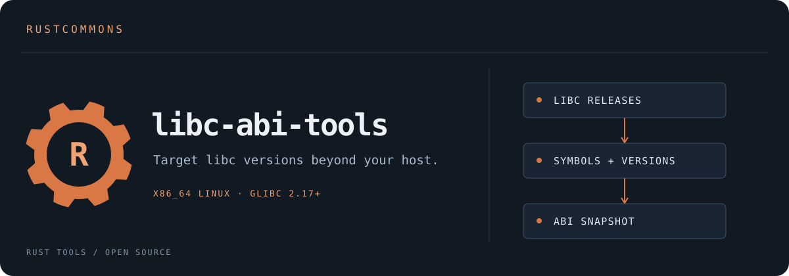

# libc-abi-tools

[Current glibc coverage](docs/GLIBC-COVERAGE.md) lists each library, test stage,
qualified input profile, and remaining runtime/architecture work.
See [CI and release artifacts](docs/CI-AND-RELEASE-ARTIFACTS.md) for Rust/Clang roles,
the shared preparation stage, and planned version-suffixed target selection.

[Browse versioned glibc interfaces](docs/reference/GLIBC-SYMBOLS.md),
[release differences](docs/reference/GLIBC-DIFFS.md), and the
[history/conformance plan](docs/GLIBC-HISTORY.md). These references distinguish
new defaults from retained compatibility interfaces and link to input provenance.

The experimental glibc 2.17/2.18/2.22 [provider contract](docs/PROVIDER-CONTRACT.md) connects
all eight generated stub libraries to the companion `cargo-libc` coordinator.
CI targets Rust 1.99.0 and Clang 21/24; the roadmap tracks each vendored version's
remaining real input and runtime setup.
The [2.22 experiment](docs/GLIBC-2.22.md) includes a source-built GNU runtime and
an explicit 2.22 symbol test; SLES qualification remains separate.
The [2.18 provider](docs/GLIBC-2.18.md) fills the first gap with pinned source
inputs, exhaustive linking, and pthread default-attribute boundary tests.

**Target libc versions beyond your host.**

[](https://github.com/rustcommons/libc-abi-tools/actions/workflows/ci.yml)

[](LICENSE)
[](data/glibc/COPYING.abilists)


Rust tools for collecting and inspecting libc ABI metadata, starting with
**x86_64 Linux glibc 2.17+**. This is a port of the glibc portion of
[Zig's libc ABI tools](https://codeberg.org/ziglang/libc-abi-tools).
Credit to the **Zig contributors** and **GNU C Library contributors** for the
tooling and source data on which this project builds. See [NOTICE.md](NOTICE.md)
for complete attribution, the source pin, and separate code/data licenses.

The companion [cargo-libc](https://github.com/rustcommons/cargo-libc) coordinates
Cargo builds with an existing sysroot or the experimental 2.17/2.18/2.22 providers.

## What works today

- Parse historical grouped ABI lists and modern per-line versioned lists.
- Load exact release snapshots for eight libraries: `m`, `c`, `ld`, `resolv`,
  `pthread`, `dl`, `rt`, and `util`.
- Export deterministic TSV or query one symbol across those libraries.
- Preserve historical symbol versions and object sizes; recognize explicit TLS
  entries when present. Absolute version-node markers and `GCC_*` entries are skipped.
- Collect the selected ABI files from a clean glibc source checkout at an exact
  `glibc-MAJOR.MINOR` tag, with source commit and license files.
- Collect defined dynamic-symbol evidence directly from ELF64 x86_64 shared
  libraries: SONAME, versions/defaults, binding, visibility, IFUNC/TLS kinds,
  64-bit sizes, and observed shared ranges. See [ELF metadata](docs/ELF-METADATA.md).

The repository includes 224 unmodified ABI lists from the pinned upstream's
**2.17 through 2.44 snapshot directories**. These are upstream labels, not a claim
about released glibc versions or tested runtime compatibility. Every snapshot is
covered by parser tests; [checksums and provenance](data/glibc/UPSTREAM.toml) are
committed with the data. Build and tests require no Zig or third-party Rust crates.

## Build and try it

Requires Rust/Cargo 1.90+; collection also requires Git. Run from this repository:

```sh
cargo test --locked --offline
cargo run --locked --offline -- glibc snapshot --data data/glibc --release 2.22 --symbol memcpy
```

Output:

```text
release target                   library symbol version       kind size
2.22    x86_64-unknown-linux-gnu   c       memcpy GLIBC_2.2.5   F    -
2.22    x86_64-unknown-linux-gnu   c       memcpy GLIBC_2.14    F    -
```

The real output uses tabs. Omit `--symbol` to export the whole release.
No matching symbol produces a header-only result. Unknown/missing releases fail;
the tool never substitutes a newer release.

```sh
cargo install --path . --locked --offline
libc-abi glibc snapshot --data data/glibc --release 2.17 > glibc-2.17.tsv
libc-abi glibc collect --source /path/to/glibc-checkout --output /path/to/new-data
libc-abi glibc elf --input /path/to/target/libc.so.6 > libc-elf.tsv
```

Installing the executable does not install the data directory; pass `--data`
explicitly. Collection refuses an existing output release and validates the
inputs before writing. An I/O failure during writing can leave a partial new
directory; inspect it before retrying. Source tags identify a checkout, not its
authenticity: use a trusted source repository.

## Why exact release snapshots?

Symbols can move between libraries. The newer file may retain an old symbol
version while moving its library membership; inferring all history from the
latest file would put it in the wrong library for older targets. Tests cover
`pthread_sigmask` moving to libc in 2.32 and startup changes in 2.34.

glibc 2.17 is a **target release floor**, not a symbol-version filter.
`GLIBC_2.2.5` still belongs in a 2.17 or 2.22 snapshot.

## What comes next

Compact cross-release consolidation, Zig `abilists` binary interoperability,
a packaged release SDK and additional provider versions are future work.
ABI lists alone do not identify every default-version alias, binding/visibility
detail, or TLS property needed for a complete generator. Headers, startup code,
nonshared objects, compiler runtimes, and oldest-target runtime tests are separate
requirements. No glibc implementation is included.

See [ROADMAP.md](docs/ROADMAP.md), [ARCHITECTURE.md](docs/ARCHITECTURE.md),
and [VALIDATION.md](docs/VALIDATION.md).

For a hands-on comparison of obtaining real glibc inputs versus building them
from source, and a verified two-function generated libc experiment, see the
[two-path C example](examples/glibc-two-paths/README.md).
The [expanded emitter experiment](docs/STUB-GENERATION.md) additionally tests
both memcpy versions, object copy-relocation, IFUNC, TLS, and observed alias storage.
The [full-library follow-up](docs/FULL-LIBRARIES.md) generates all pinned public
glibc 2.17 exports in the eight selected libraries and passes C/Rust runtime checks.
