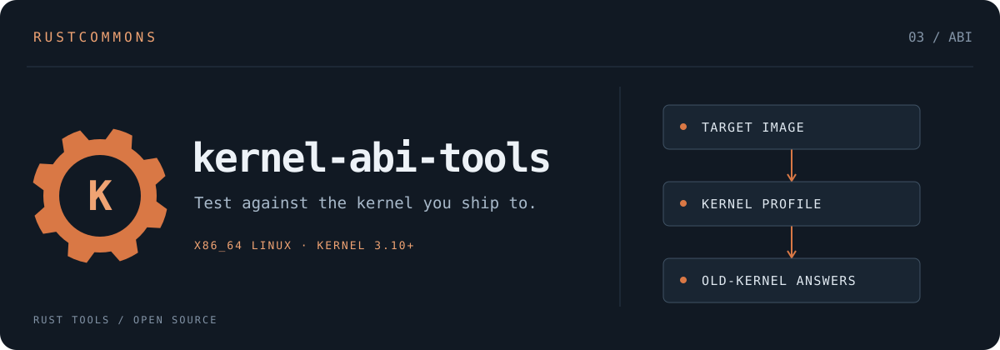

# kernel-abi-tools

**Test against the kernel you ship to.**

[](https://github.com/rustcommons/linux-abi-tools/actions/workflows/kernel-abi-tools.yml)

[](LICENSE)


Linux kernel ABI data and seccomp profiles that make a modern host kernel
answer like an older one. Run a Rust binary in a container of the target
distribution with a profile for its kernel, and:

- **Syscalls the kernel lacks** return `ENOSYS`, as on the real machine.
- **`madvise` advice values it does not know** return `EINVAL` (for example
  `MADV_POPULATE_READ` on 4.12, the kernel of SLES 12 SP5).

Part of the [linux-abi-tools](../../README.md) workspace, beside
`libc-abi-tools` (glibc ABI data) and [`linux-targets`](../linux-targets/README.md)
(distribution presets), and used by [cargo-libc](https://github.com/rustcommons/cargo-libc).
The glibc side answers "will it link and load?"; this crate answers "will its
syscalls work on that kernel?". Initial scope: **x86_64 Linux**. Std-only
Rust; its only dependency is `linux-targets`. Works offline.

As a library, `container::run` runs a program under a profile and
`seccomp_profile` returns the profile JSON, so a consumer such as cargo-libc
does not need the `kernel-seccomp` binary.

**Status: prototype.** Every profile is verified in CI (see
[Verification](#verification)); vendor kernel backports and most flag-level
differences are not modelled yet. See [docs/ROADMAP.md](docs/ROADMAP.md).

## Contents

| Path | Purpose |
| --- | --- |
| `data/linux/syscalls-x86_64.tsv` | Every x86_64 syscall and the first mainline release whose table lists it (v3.3 to v7.2, from 81 kernel tags) |
| `data/linux/madvise-x86_64.tsv` | Every `madvise` advice value and the first release defining it |
| `../linux-targets` (dependency) | 28 distribution presets: kernel floor, glibc, container image |
| `profiles/kernel/linux-X.Y.json` | 19 generic kernel profiles |
| `profiles/distro/ID.json` | One profile per distribution preset |
| `kernel-seccomp` | Generates profiles, runs programs under them, verifies release bundles |
| `syscall-probe` | Proves a profile simulates its kernel on your host and runtime |
| `scripts/self-test.sh` | Runs the probe against any set of profiles |
| `scripts/run-under-kernel.sh` | Thin wrapper over `kernel-seccomp run` |
| `scripts/package-release.sh` | Builds the reproducible release bundle |
| `scripts/install-crun.sh` | Pinned, checksum-verified static crun for hosts with an old libseccomp |

## Usage

```bash
cargo build -p kernel-abi-tools --release        # from the repository root
target/release/kernel-seccomp distros
target/release/kernel-seccomp missing --distro sles-12-sp5
target/release/kernel-seccomp profile --kernel 4.12 --output linux-4.12.json

# Run a binary in SLES 12 SP5 userland as Linux 4.12 would answer it
target/release/kernel-seccomp run --distro sles-12-sp5 -- ./my-app args
```

`run` mounts the working directory, and the program file if it is outside it,
at their own absolute paths, and forwards `CARGO*`/`RUST*` variables. A bare
program name (`sh`) runs from the image. Engine and runtime options come from
`CONTAINER_ENGINE` (default `podman`), `KERNEL_ABI_ENGINE_ARGS` (e.g.
`--runtime crun`) and `KERNEL_ABI_RUN_ARGS` (e.g. `--network none`).

### As a Cargo runner

Cargo runs every `cargo run` / `cargo test` binary through the runner, so the
whole test suite executes in the simulated environment:

```toml
# .cargo/config.toml
[target.x86_64-unknown-linux-gnu]
runner = ["/opt/kernel-abi-tools/bin/kernel-seccomp", "run", "--distro", "sles-12-sp5", "--"]
```

The binary must be built for a glibc no newer than the image's (use
cargo-libc). Test data must live under the package directory, which is the
working directory Cargo uses for tests.

## How a profile works

A profile is an OCI seccomp profile (Podman, Docker, CRI-O):

- **Default action `ENOSYS`; allowlist of the syscalls the target kernel has.**
  It is an allowlist because runtimes resolve names with their own libseccomp
  and silently drop names it does not know. A blocklist would fail open for the
  newest syscalls, which is exactly what we observed during development (13
  syscalls from 6.8 onward reached the kernel). With the allowlist an unknown
  name fails closed and the probe reports it.
- **One `madvise` rule per advice value** (allowed or `EINVAL`), plus one for
  values above the highest known. No two rules overlap, so the result never
  depends on how a runtime orders conflicting rules.

Profiles are a testing aid, not a security boundary.

## Runtime requirements

| Runtime | Works for | Why |
| --- | --- | --- |
| **crun with libseccomp ≥ 2.6** (e.g. the static build from `scripts/install-crun.sh`) | All profiles | Applies the filter immediately before `execve`, and names every syscall |
| crun or runc with libseccomp 2.5.x | Kernels 4.11 to 6.7 | libseccomp 2.5 cannot name 6.8+ syscalls; runc's init also calls `statx` (4.11) after installing the filter, so runc cannot start older profiles |

Select a runtime with `KERNEL_ABI_ENGINE_ARGS="--runtime crun"` or
`--runtime /path/to/crun`.

## Verification

- **CI on every push:** every generic and preset profile tested in SLES 12 SP5
  userland. This uses the release bundle's own static probe under static crun
  1.28, on GitHub's Ubuntu 24.04 runner. Each profile runs 68 syscall checks
  and 107 `madvise` checks.
- **Local, 2026-10-10:** host kernel 6.18 (WSL2), Podman 5.8, crun 1.28. All
  profiles pass; the only skip is `map_shadow_stack`, which that host kernel
  also lacks.
- **End to end:** a memmap2 reader built with a glibc 2.17 floor runs correctly
  in SLES 12 SP5 userland under the 4.12 profile. The same program built
  normally on Ubuntu 24.04 is rejected by the SLES loader (`GLIBC_2.28` not
  found).

## Releases

Each release publishes one bundle: static binaries, all profiles and data, a
`kernel-abi-provider-v1` descriptor, and a SHA-256 inventory. The archive is
reproducible from its commit. See [docs/RELEASE.md](docs/RELEASE.md) for
publishing and for taking a release onto a disconnected network, and
[docs/PROVIDER-CONTRACT.md](docs/PROVIDER-CONTRACT.md) for how a consumer
such as cargo-libc uses a bundle.

## What this does not cover

- **Other flags and behavior:** only `madvise` advice is modelled. `mmap`
  silently ignores unknown flags, which seccomp cannot reproduce, and flags
  on `memfd_create`, `openat`, `statx` and `clone` are on the roadmap.
- **Vendor backports:** presets use the mainline base, so a profile can be
  stricter than the real vendor kernel, never looser.
- **Kernels before 3.3:** the data floor is v3.3. Rust std's documented
  minimum, 3.2, is treated as 3.3.
- **Final qualification:** run on a real VM of the target release before you
  ship.

## Refreshing the data (online, occasional)

```bash
scripts/fetch-syscall-tables.sh /tmp/raw
scripts/build-syscall-data.sh /tmp/raw data/linux/syscalls-x86_64.tsv
scripts/build-madvise-data.sh /tmp/raw data/linux/madvise-x86_64.tsv
cargo test -p kernel-abi-tools && ../../target/release/kernel-seccomp generate profiles
```
