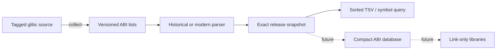

# Architecture

The initial pipeline is deliberately small:

`version.rs` parses numeric symbol versions independently of release policy.
`glibc.rs` owns glibc file layouts, parser rules, release snapshots, and source
collection. `main.rs` handles CLI arguments and presentation. No external Rust
dependencies or unsafe code are used.

## Inputs and invariants

- Targets: x86_64 GNU/Linux only. Data under `x86_64/64` excludes the x32 ABI.
- Release directories: glibc 2.17+; 2.17–2.19 use the historical `nptl` subdirectory.
- Versions below 2.17 are still parsed when attached to symbols.
- Old lists group indented rows under a `GLIBC_*` line. New lists repeat that
  version on each row. Both produce the same `Symbol` representation.
- A symbol retains its name, version, and kind (`F`, `D` + size, or explicit `T`
  + size). `A` version-node markers and `GCC_*` rows are not exported.
- Unknown/nonnumeric namespaces, unknown kinds, conflicting duplicates, and
  malformed or oversized sizes are errors with file/line context.
- Library order in exported TSV is lexical; symbols sort by name then numeric
  version. No timestamps or absolute build paths appear in output.
- Each required input is limited to 10 MiB. All eight library files must exist;
  a missing file is not interpreted as an empty library.
- Canonical file paths must remain inside the source release directory.

## Exact snapshots versus consolidation

Each snapshot comes entirely from that release's own ABI files. This preserves
actual library membership and avoids applying a newer library location to an
older target. For example, `pthread_sigmask` appears in libc in 2.32 with older
version tags; that does not make it a libc export on 2.31.

Zig's pinned consolidator processes release history to encode inclusions into
one compact binary database. Our first milestone does not port that algorithm
or its binary format. Exact snapshots provide testable source evidence for that
next phase. The pinned Zig consolidator skips grouped files before 2.23; this
parser deliberately adds that format to inspect the 2.17 baseline directly.

## What ABI lists cannot establish

The supplied glibc lists identify F/D/A entries. They do not provide all ELF
default-version, visibility, weak binding, alias, or TLS details. Parsing explicit
T entries does not mean the bundled files fully identify thread-local exports.
Those gaps require authoritative ELF/source evidence before generating DSOs.

Link-only DSOs also cannot replace real CRT/nonshared code, libc implementations,
headers, or compiler runtimes. The snapshot data is not currently consumed by
`cargo-libc`; it continues to require a real target sysroot.

## Updating upstream

Start from the commit in `data/glibc/UPSTREAM.toml`. Review upstream code and data
changes, then copy only the selected files with their original bytes and paths.
Update that pin and `SHA256SUMS` together; preserve `COPYING.abilists` and Zig's
MIT notice. Run the all-snapshot regression tests and review the exported ABI
diffs. Do not relabel an unqualified snapshot as a supported runtime release.
